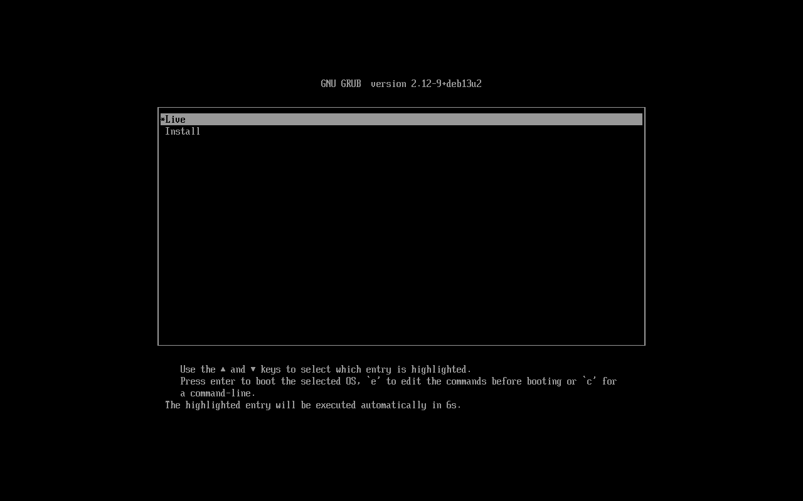
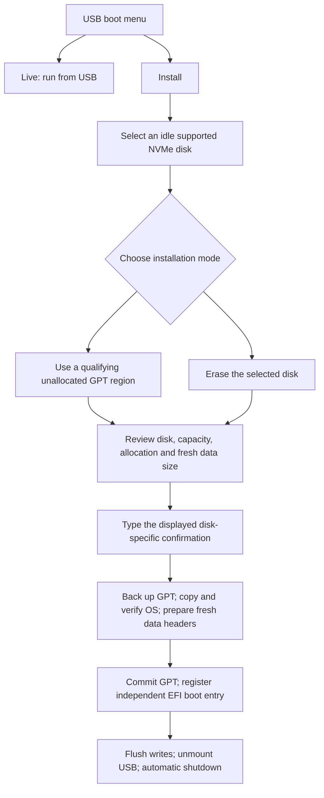
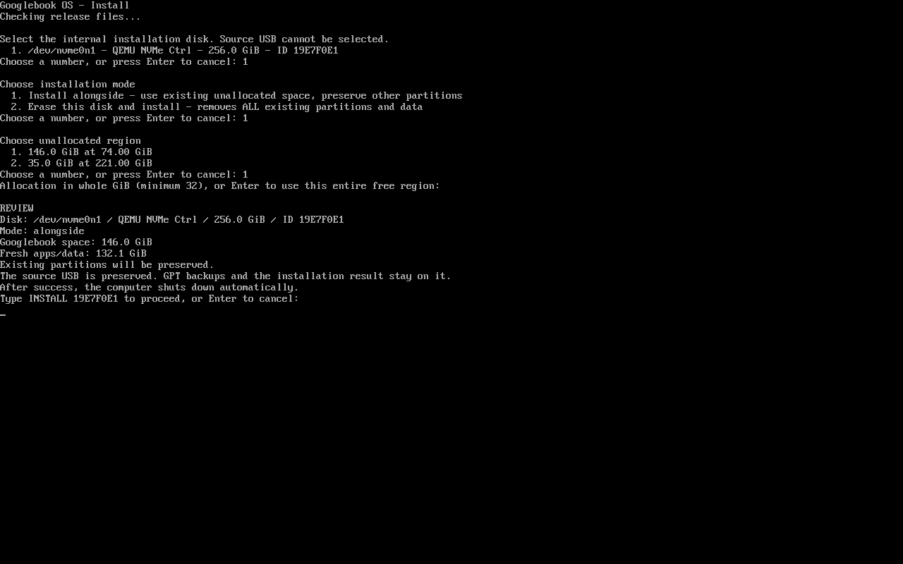

# Build, flash and install

There is currently no prebuilt image download. Start with
[the source-build guide](BUILD.md): it explains how to obtain the public inputs
and create `.build/release/googlebook-x86.img`. The rest of this guide assumes
that build finished successfully and its checksum passed.

## Prepare the USB

Use a spare **64 GB or larger USB**. Flashing replaces its partitions and files.
The image contains a fresh setup, not the builder's account, apps or game saves.

On Windows or Linux, a graphical raw-image writer such as
[balenaEtcher](https://etcher.balena.io/) can write `googlebook-x86.img`.
Select the image file, identify the intended USB by its model and capacity,
then flash and wait for verification. Do not select an internal SSD as the
flashing target. Do not merely copy the image file onto a formatted USB.

For Windows/WSL, copy the `.img` file and `SHA256SUMS` into a Windows-accessible
folder first. Allow at least 37 GB there for the expanded copy. In PowerShell,
run this from that folder and compare its hash with the `.img` line in
`SHA256SUMS`:

```powershell
Get-FileHash -Algorithm SHA256 -LiteralPath .\googlebook-x86.img
```

After flashing, cancel any Windows request to format the unfamiliar partitions.
Safely eject the USB, connect it to the test laptop, and use its firmware boot
menu to select the USB in **UEFI** mode. Secure Boot must be disabled for this
unsigned experimental image. Keep disk-encryption recovery keys available
before changing firmware settings. On the tested ASUS, Esc opens the boot menu.

Select **Live first** and verify that setup, graphics, keyboard, touchpad,
wireless and speakers work on the target device. Only consider **Install**
after that hardware test. Other laptop models have not been physically tested.

## The boot menu

Actual menu captured in the file-backed UEFI walkthrough:





## Live

Boot the release USB in UEFI mode and select **Live**, the default. Its setup,
apps and saves stay on the USB. A slow flash drive can still cause stalls.
Selecting Live does not launch the installer or repartition the internal disk.

## Install

Back up important files and keep any existing disk-encryption recovery key
before changing firmware boot settings. Flashing a release image replaces the
selected USB's contents; use a spare USB for a fresh release test.

1. Connect power and boot **Install**. The installer checks release files before
   offering disk choices. The source USB is excluded.
2. Select the disk by its **device, model, capacity and displayed ID**. The
   installer refuses mounted disks/partitions and active storage holders.
3. Choose a mode:
   - **Alongside:** select an existing free GPT region of at least 32 GiB.
     Optionally enter a whole-GiB allocation size. Fragmented smaller gaps are
     not combined. Shrink Windows first using its own tools if needed; leave
     the resulting region unallocated.
   - **Erase:** all partitions on that selected disk are replaced. The whole
     usable capacity is allocated to Googlebook; no existing OS is preserved.
4. Review the final summary. Type the exact **INSTALL ID** or **ERASE ID**
   shown on screen. IDs identify the selected disk. There is no preselected
   disk or automatic destructive default; Enter cancels.
5. Leave power/USB connected. The live bar counts completed copy/readback work
   and reports I/O waits. Only 2 MiB of userdata headers are cleared. Every OS
   chunk, including zeros, is written and verified before the GPT commit.
6. Successful installation flushes writes and its USB log, unmounts the stage,
   waits 10 seconds and shuts down. No final keypress is required. A failure
   stays on screen instead.
7. Remove the USB, power on and choose the new **Googlebook** firmware entry.
   For dual boot, the prior boot order stays first; choose Googlebook in the
   firmware boot menu when wanted. Initial setup creates fresh encrypted data.

The installer writes its original GPT backup, plan and result to the release
USB. These are private machine-specific files; do not publish them in an issue.
If a copy fails while the original GPT is intact, it can be retried from the
beginning. Inconsistent GPT copies and an already installed Googlebook disk
are not automatically repaired or overwritten. Keep the USB and backups.

This is the review screen from a simulated 256 GiB disk. The walkthrough
cancelled here; it never sent the installation confirmation:



Erase mode removes the disk's partitions/files from normal use. It does not
zero every raw byte and must not be used as a secure disposal/sanitization tool.
